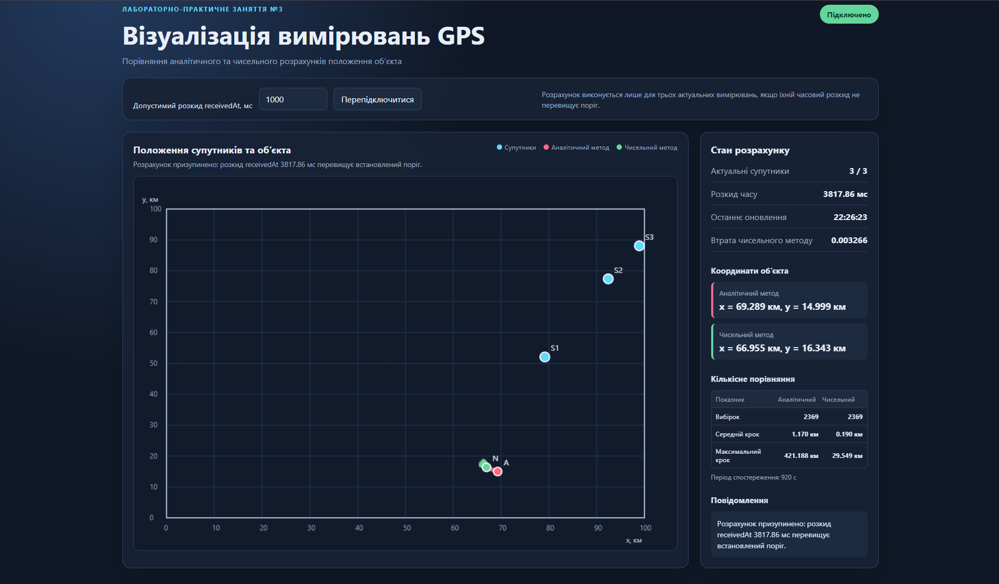

# Лабораторно-практичне заняття №3

## Візуалізація вимірювань GPS

## Мета роботи

Розробити вебдодаток, який отримує вимірювання від емулятора GPS через WebSocket, визначає положення об’єкта за відстанями до трьох супутників двома методами та відображає результати на графіку в декартових координатах.

## Опис розробленого додатка

Додаток у реальному часі:

- підключається до GPS-емулятора через `ws://localhost:21701`;
- зберігає останнє вимірювання для кожного супутника;
- обчислює відстані до супутників;
- перевіряє актуальність та часовий розкид вимірювань;
- визначає положення об’єкта аналітичним методом;
- визначає положення об’єкта чисельним методом градієнтного спуску;
- відображає супутники та обидва результати на графіку з діапазоном від 0 до 100 км;
- показує затухаючий слід руху об’єкта;
- накопичує статистику стрибків координат для порівняння методів.

## Обраний варіант чисельного методу

Обрано варіант 2 з умови роботи: власна реалізація функції мінімізації на JavaScript.

Для пошуку координат використовується метод градієнтного спуску. На кожній ітерації обчислюється градієнт функції втрат, після чого координати зміщуються в напрямку антиградієнта. Якщо нова точка збільшує функцію втрат, крок зменшується.

## Використані технології

- HTML5;
- CSS3;
- JavaScript;
- WebSocket;
- Canvas API;
- Docker.

Сторонні математичні бібліотеки не використовуються.

## Структура проєкту

```text
index.html                 інтерфейс додатка
style.css                  стилі та адаптивне оформлення
app.js                     WebSocket, розрахунки та графік
docs/screenshots/gps-app.png  скріншот роботи додатка
```

## Вимоги до запуску

Для запуску потрібні:

- Docker;
- Python 3 або інший локальний HTTP-сервер;
- браузер із підтримкою WebSocket та Canvas.

## Запуск GPS-емулятора

Завантажити Docker-образ:

```bash
docker pull iperekrestov/university:gps-emulation-service-2026
```

Запустити контейнер:

```bash
docker run --rm --name gps-emulator -p 21701:4000 iperekrestov/university:gps-emulation-service-2026
```

Перевірити доступність емулятора:

```bash
curl http://localhost:21701/config
```

У відповіді очікується конфігурація зони, частоти повідомлень, швидкості супутників та об’єкта.

## Запуск вебдодатка

У другому вікні термінала перейти до кореня проєкту та запустити локальний HTTP-сервер:

```bash
python -m http.server 8000
```

Відкрити в браузері:

```text
http://localhost:8000
```

Після завантаження сторінки додаток автоматично підключається до емулятора. Якщо з’єднання було втрачено, виконується автоматична спроба перепідключення. Для ручного перепідключення використовується кнопка `Перепідключитися`.

## Підготовка вимірювань

Кожне повідомлення емулятора містить:

```json
{
  "id": "ідентифікатор супутника",
  "x": 98.52,
  "y": 22.72,
  "sentAt": 1789924806314,
  "receivedAt": 1789924806314.2195
}
```

Координати супутників задано в кілометрах. Часові мітки задано в мілісекундах.

Для кожного `id` зберігається лише останнє вимірювання. Якщо вимірювання супутника не оновлювалося понад 5 секунд, воно вилучається з набору актуальних даних.

Відстань до супутника обчислюється за формулою:

```text
R = 300 * (receivedAt - sentAt)
```

Коефіцієнт 300 має одиниці км/мс, оскільки швидкість світла приблизно дорівнює 300 000 км/с.

Перед розрахунком обираються три останні вимірювання від різних супутників. Для контролю синхронності визначається:

```text
spread = max(receivedAt) - min(receivedAt)
```

Якщо `spread` перевищує встановлений поріг, розрахунок не виконується. Поточний розкид та поріг відображаються в інтерфейсі.

## Обґрунтування порогу розкиду часу

У додатку встановлено початковий поріг `1000 мс`. Значення можна змінити у відповідному полі інтерфейсу.

Емулятор надсилає повідомлення від супутників незалежно, тому три вимірювання не надходять одночасно. За одну секунду об’єкт продовжує рухатися, тому використання значно старішого вимірювання може додати до похибки трилатерації похибку, пов’язану з переміщенням об’єкта.

В умові роботи зазначено, що похибка вимірювання дальності становить близько 100 м. Тому розкид до однієї секунди є компромісом між двома вимогами:

1. не використовувати вимірювання, які стали надто застарілими через рух об’єкта;
2. не пропускати більшість розрахунків через незначну різницю моментів отримання повідомлень.

Фактичний розкид вимірювань показується на екрані, тому поріг можна перевірити та скоригувати під час експерименту.

## Аналітичний метод

Для супутників `(x1, y1)`, `(x2, y2)`, `(x3, y3)` та відстаней `r1`, `r2`, `r3` обчислюються коефіцієнти:

```text
A = 2 * (x2 - x1)
B = 2 * (y2 - y1)
C = r1^2 - r2^2 - x1^2 + x2^2 - y1^2 + y2^2

D = 2 * (x3 - x2)
E = 2 * (y3 - y2)
F = r2^2 - r3^2 - x2^2 + x3^2 - y2^2 + y3^2
```

Координати об’єкта:

```text
x = (C * E - F * B) / (E * A - B * D)
y = (C * D - A * F) / (B * D - A * E)
```

Якщо знаменник близький до нуля, супутники розташовані майже на одній прямій. У цьому випадку аналітичний метод вважається нестійким, а некоректна точка не відображається.

## Чисельний метод

Мінімізується функція втрат:

```text
L(x, y) = sum((sqrt((x - xi)^2 + (y - yi)^2) - ri)^2)
```

Реалізований алгоритм:

1. як початкове наближення використовується коректний аналітичний результат;
2. якщо аналітичний результат недоступний, використовується попереднє чисельне положення;
3. якщо попереднього положення немає, використовується точка `(50, 50)`;
4. обчислюється градієнт функції втрат;
5. координати переміщуються на крок у напрямку антиградієнта;
6. якщо функція втрат зростає, крок зменшується;
7. після завершення ітерацій результат перевіряється на коректність числових значень.

Поточне значення функції втрат відображається у правій частині інтерфейсу.

## Інтерфейс та позначення

Інтерфейс містить:

- статус WebSocket-з’єднання;
- поле допустимого розкиду `receivedAt`;
- кнопку перепідключення;
- графік координат;
- кількість актуальних супутників;
- фактичний часовий розкид;
- координати об’єкта за двома методами;
- значення функції втрат;
- кількісну статистику стрибків;
- повідомлення про помилки та пропущені розрахунки.

Позначення на графіку:

- блакитні точки `S1`, `S2`, `S3` є супутниками;
- червона точка `A` є результатом аналітичного методу;
- зелена точка `N` є результатом чисельного методу;
- червоний слід є траєкторією аналітичних положень;
- зелений слід є траєкторією чисельних положень.

## Виконання додаткових завдань

### Слід руху об’єкта

Для кожного коректного розрахунку зберігаються положення об’єкта, отримані обома методами. На графіку вони з’єднуються лініями та поступово згасають протягом 30 секунд. Старі точки автоматично вилучаються з візуального сліду.

### Кількісне порівняння методів

Для кожного методу накопичуються:

- кількість розрахованих положень;
- середній крок між послідовними положеннями;
- максимальний крок між послідовними положеннями;
- тривалість періоду спостереження.

Крок визначається за формулою:

```text
step = sqrt((xcurrent - xprevious)^2 + (ycurrent - yprevious)^2)
```

Середній крок показує типову величину зміни положення, а максимальний крок характеризує найбільший стрибок результату. Для зашумлених вимірювань очікується, що аналітичний метод матиме більші середній та максимальний кроки, а чисельний метод буде стабільнішим.

## Порівняння методів та висновки

Аналітичний метод дає точний результат для ідеальних вимірювань, оскільки безпосередньо розв’язує систему рівнянь. Його недоліком є чутливість до шуму вимірювань та геометрії розташування супутників. Через це аналітична точка може помітно змінювати положення між послідовними наборами даних.

Чисельний метод мінімізує сумарну похибку для всіх супутників. Він краще згладжує випадкові похибки дальності та зазвичай формує стабільнішу траєкторію. Недоліком є залежність від початкового наближення та параметрів ітераційного алгоритму.

Під час роботи додатка різницю між методами можна оцінити візуально за слідами та кількісно за середнім і максимальним кроками. Очікуваний результат полягає в тому, що слід аналітичного методу буде більш нерівномірним, а чисельний метод матиме менші стрибки координат.

## Скріншот роботи

Скріншот інтерфейсу під час запуску локального додатка та GPS-емулятора:


